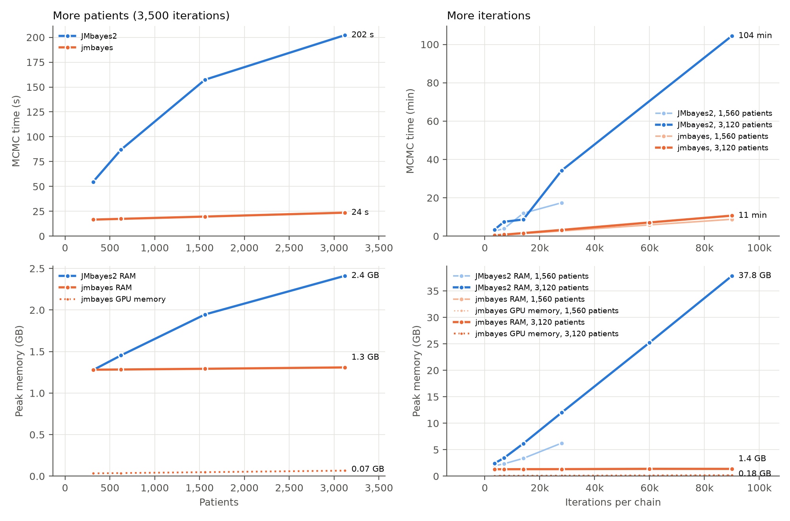
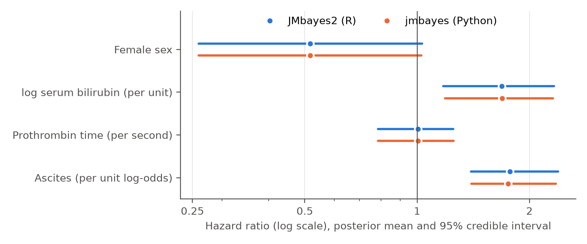

# `jmbayes`: JMBayes2 Accelerated Python Implementation

Bayesian joint models for longitudinal and time-to-event data, in Python on the GPU.
**10× faster than JMbayes2 with 27× less memory on the largest problem we tested, and the
same results. The gap grows with problem size.**

|  | JMbayes2 | jmbayes |
|---|---:|---:|
| 3,120 patients, 90,000 iterations | 104 min, 37.8 GB RAM | **11 min, 1.4 GB RAM** |

jmbayes is a reimplementation of the R package
[JMbayes2](https://github.com/drizopoulos/JMbayes2) by Rizopoulos, Papageorgiou and
Miranda Afonso: the same model, the same priors and the same MCMC algorithm.

* **Long runs on large cohorts, on ordinary hardware.** jmbayes uses 1.3–1.4 GB of RAM
  and under 0.2 GB of GPU memory in every run we measured, from 3,500 to 90,000
  iterations. JMbayes2's memory grows with cohort size × run length: for 3,120 patients
  it needs 12 GB at 28,000 iterations and 38 GB at 90,000, more than most machines have.
* **The bigger the problem, the bigger the gap.** 3.3× faster than JMbayes2 on 312
  patients, 8–9× on 1,560–3,120 patients at JMbayes2's default run length, and 10× on
  long runs, still growing at the largest size we tested. With ten times the patients, jmbayes takes 1.4× longer and JMbayes2 3.7× longer
  (see [Benchmarks](#benchmarks)).
* **The same answers, formally tested.** In equivalence tests against JMbayes2, all 50
  model parameters agree within 0.2 posterior SD and every regression coefficient leads
  to the same conclusion. jmbayes and JMbayes2 differ from each other no more than two
  JMbayes2 runs with different seeds do.
* **Competing risks and prediction accuracy.** Cause-specific hazards as in JMbayes2,
  and time-dependent AUC, ROC, Brier score and calibration that reproduce JMbayes2's
  numbers.
* **The marker types and survival data of JMbayes2.** Gaussian, binomial (with trials),
  Poisson, negative binomial, Student's t, beta, gamma, censored normal, beta-binomial and
  unit Lindley markers; strata, late entry, covariates that change over time, interval
  censoring and recurrent events with a frailty; marginal and conditional DIC, WAIC and
  LPML. Each tested against JMbayes2.
* **A Python interface**, plus JMbayes2-style formula strings if you prefer them.

## Install

jmbayes runs on any CPU, and on NVIDIA GPUs through PyTorch. Install PyTorch first, in
the version that fits your machine, then this package.

**With pip**

```
python -m venv .venv
.venv\Scripts\activate             # macOS/Linux: source .venv/bin/activate
pip install torch                  # see the note below for an NVIDIA GPU on Windows
pip install jmbayes
```

**With conda**

```
conda create -n jmbayes -c conda-forge python=3.11 pytorch numpy scipy pandas statsmodels
conda activate jmbayes
pip install --no-deps jmbayes
```

**From source** (for the benchmarks, or to change the code): `git clone
https://github.com/neuratom/jmbayes.git`, then `pip install -e .` in that folder.

conda-forge picks a GPU build of PyTorch by itself when it finds an NVIDIA driver.

**GPU note.** With pip on Linux, `pip install torch` already includes GPU support. On Windows
it installs the CPU-only build, so use the command that the selector at
[pytorch.org/get-started](https://pytorch.org/get-started/locally/) gives for your CUDA
version (run `nvidia-smi` to see it). Check that the GPU is found:

```
python -c "import torch; print(torch.cuda.is_available())"
```

`False` is fine: everything runs on the CPU, just slower for large studies. Apple GPUs are
not supported yet.

## Fit a model

```python
import jmbayes as jmb
from jmbayes import var

visits, patients = jmb.datasets.pbc2()   # example data: visits, and one row per patient
year, sex = var("year"), var("sex")

model = jmb.JointModel(
    event=jmb.Event(time="years", event="status2", covariates=sex),
    markers=[
        jmb.Marker(var("serBilir").log(), fixed=year * sex, random=year),
        jmb.Marker("ascites", fixed=year + sex, random=year, family="binomial"),
    ],
    id="id", time="year",
)
fit = model.fit(visits, patients)
fit.summary()
```

## Benchmarks

The model is the JMbayes2 README model: pbc2, three markers (log serum bilirubin,
prothrombin time, ascites), replicated to get more patients. Each run uses 3 chains.
JMbayes2 runs its chains in parallel on the CPU; jmbayes ran on the GPU in float32, its
default. All runs were on one machine, one run at a time:

| | |
|---|---|
| CPU | Intel Core i9-12900K, x86-64 (16 cores: 8 performance + 8 efficiency, 24 threads) |
| RAM | 64 GB |
| GPU | NVIDIA GeForce RTX 3090, 24 GB |
| Software | Windows 11; R 4.6.2 with JMbayes2 0.6-5; Python 3.11, PyTorch 2.6 (CUDA 12.4) |



The two programs agree. Hazard ratios from the same model, fitted by each program
(posterior mean and 95% credible interval):



| Patients | Iterations | JMbayes2: MCMC time | JMbayes2: peak RAM | jmbayes: MCMC time | jmbayes: peak RAM | Speed-up |
|---:|---:|---:|---:|---:|---:|---:|
| 312   | 3,500  | 55 s    | 1.28 GB | 17 s  | 1.28 GB | 3.3× |
| 624   | 3,500  | 87 s    | 1.45 GB | 17 s  | 1.28 GB | 5.0× |
| 1,560 | 3,500  | 157 s   | 1.95 GB | 20 s  | 1.29 GB | 8.0× |
| 3,120 | 3,500  | 202 s   | 2.41 GB | 24 s  | 1.31 GB | 8.6× |
| 1,560 | 7,000  | 237 s   | 2.34 GB | 41 s  | 1.29 GB | 5.8× |
| 1,560 | 14,000 | 716 s   | 3.36 GB | 82 s  | 1.30 GB | 8.8× |
| 1,560 | 28,000 | 1,046 s | 6.25 GB | 164 s | 1.31 GB | 6.4× |
| 3,120 | 7,000  | 450 s   | 3.44 GB | 48 s  | 1.31 GB | 9.4× |
| 3,120 | 14,000 | 521 s   | 6.15 GB | 96 s  | 1.32 GB | 5.4× |
| 3,120 | 28,000 | 2,056 s | 12.0 GB | 196 s | 1.33 GB | 10.5× |
| 3,120 | 60,000 | 5,893 s* | 25.2 GB | 429 s | 1.39 GB | |
| 1,560 | 90,000 | -       | -       | 529 s | 1.36 GB | |
| 3,120 | 90,000 | 6,266 s | 37.8 GB | 643 s | 1.38 GB | 9.7× |

\* This JMbayes2 run overlapped with other work on the machine (98 ms per iteration,
against 70–73 ms at 28,000 and 90,000 iterations), so no speed-up is given for it.

The speed comes from the GPU. On the CPU alone, jmbayes is about as fast as JMbayes2 on
small cohorts and slower on large ones, with less than half the memory (the CPU runs are
in the report).

jmbayes computes in float32 by default; `fit(..., dtype="float64")` gives 64-bit precision.
The results are statistically the same: both are equivalent to JMbayes2 in the same tests
([float64 report](https://github.com/neuratom/jmbayes/blob/main/benchmark/jmbayes_float64_vs_JMbayes2.pdf)).

The full report, with equivalence tests, hazard ratios, credible intervals, convergence
(Rhat) and scaling plots, is in [benchmark/jmbayes_vs_JMbayes2.pdf](https://github.com/neuratom/jmbayes/blob/main/benchmark/jmbayes_vs_JMbayes2.pdf).
The scripts that reproduce it are in [benchmark/](https://github.com/neuratom/jmbayes/tree/main/benchmark). The R scripts need
JMbayes2 installed from CRAN, and are only used for the comparison.

## Writing terms

Terms are Python objects and combine with operators:

| You write | Meaning |
|---|---|
| `year + sex` | main effects |
| `year * sex` | main effects and their interaction |
| `year & sex` | the interaction only |
| `year.ns(2)`, `year.bs(3)` | natural / B-spline of year with 2 / 3 degrees of freedom |
| `var("serBilir").log()` | log-transformed marker (also `.sqrt()`) |

Plain column names work too: `fixed=["year", "sex", ("year", "sex")]` (a tuple is an
interaction), or `covariates="sex"`. The intercept is always included.

## Get the results

```python
fit.hazard_ratios()                   # HR, 95% credible interval, P
fit.coefficients("log(serBilir)")     # fixed effects of one marker
fit.random_effects_covariance()       # matrix D
fit.fit_statistics                    # DIC, WAIC, LPML

fit.save("model.jmb")                 # later: fit = jmb.load("model.jmb")
```

## Predict for a patient

```python
new = visits[(visits.id == 93) & (visits.year < 5)].copy()   # measurements up to year 5
new["years"] = 5                                              # event-free up to year 5
new["status2"] = 0

fit.predict(new, times=[5, 6, 7, 8, 10])          # risk of the event by each time
fit.predict(new, process="longitudinal")          # expected marker values
```

To predict, the patient's random effects are sampled given their data so far. jmbayes
does this step slightly differently from JMbayes2, which we believe weights the
"event-free so far" information inconsistently (details in
[NOTES.md](https://github.com/neuratom/jmbayes/blob/main/NOTES.md)). Risks can differ
from JMbayes2's by a few percentage points for some patients (up to 0.07 for PBC
patient 93). `fit.predict(..., r_sampling=True)` uses JMbayes2's method; given the same
posterior draws, it matches JMbayes2's predictions to within 0.01.

## Check how good the predictions are

Using each patient's measurements up to year 5, how well does the model predict who has
the event by year 7? Pass data the model has not seen (e.g. a test set) for an honest
answer; here the fitting data is used for brevity:

```python
fit.tv_auc(visits, t_start=5, dt=2)        # discrimination: time-dependent AUC
fit.tv_roc(visits, t_start=5, dt=2)        # sensitivity and specificity per cut-off
fit.tv_brier(visits, t_start=5, dt=2)      # Brier score (integrated=True: over years 5-7)
fit.calibration(visits, t_start=5, dt=2)   # ICI, E50, E90; .curve for a calibration plot
```

These follow JMbayes2's `tvAUC()`, `tvROC()`, `tvBrier()` and `calibration_metrics()`,
and give the same numbers from the same predicted risks. Patients censored before the
horizon are handled with model-based weights by default (`weights="IPCW"` for
Kaplan-Meier weights).

## Competing risks

When patients can have one of several events, name the value that means censored; every
other value of the event column is a cause:

```python
patients["status"] = pd.Categorical(patients["status"], ["alive", "transplanted", "dead"])

model = jmb.JointModel(
    jmb.Event("years", "status", sex, censored="alive"),
    [jmb.Marker(var("serBilir").log(), fixed=year * sex, random=year)],
    id="id", time="year")
fit = model.fit(visits, patients)
fit.hazard_ratios()      # one row per effect and cause, e.g. "sexfemale [dead]"
```

This is the model JMbayes2 fits with `crisk_setup()` and `strata(CR)`: each cause has its
own baseline hazard, covariate effects and marker associations. `fit.predict(...)` gives
each cause's cumulative incidence (column `cause`). For death and transplantation in PBC,
none of the 50 parameters differed from JMbayes2 in the same equivalence tests, and the
hazard ratios agreed to two decimals
([benchmark/compare_cr.py](https://github.com/neuratom/jmbayes/blob/main/benchmark/compare_cr.py)).
JMbayes2 0.6-5's own `predict()` fails on this model, so the cumulative incidences were
checked internally: summed over causes they match the overall risk. As in JMbayes2, the
accuracy measures above are for single-event models only.

## More marker types and survival data

**Marker types.** Besides `"gaussian"` and `"binomial"`, a marker can be:

```python
jmb.Marker("seizures", fixed=year, random=year, family="poisson")            # counts
jmb.Marker("platelets", fixed=year, random=year, family="negative_binomial") # overdispersed counts
jmb.Marker("prothrombin", fixed=year, random=year, family="student_t", df=4) # robust to outliers
jmb.Marker("serBilir", fixed=year, random=year, family="gamma")              # positive, skewed
jmb.Marker("fraction", fixed=year, random=year, family="beta")               # in (0, 1)
jmb.Marker("fraction", fixed=year, random=year, family="unit_lindley")       # in (0, 1)
jmb.Marker("viral_load", fixed=year, random=year, family="censored_normal",
           censoring="below_limit")       # 0 measured, 1 below the limit, 2 above
jmb.Marker("n_positive", fixed=year, family="binomial", trials="n_tested")   # k out of n
jmb.Marker("n_positive", fixed=year, family="beta_binomial", trials=3)       # overdispersed
```

Count and gamma markers use a log link, beta, unit Lindley and the binomial families a
logit link, so `value(marker)` in the hazard is on that scale (e.g. the log of the
expected count). Student's t needs its degrees of freedom (`df`), as in JMbayes2.
`trials` (a column or a number) gives the number of trials of each measurement, as
`cbind(successes, failures)` in R. In `fit.coefficients(...)`, `sigma` is the size of a
negative binomial marker (variance mu + mu²/size), the scale of a Student's t marker, the
precision of beta and beta-binomial markers, and the shape of a gamma marker.

**Strata.** Each group gets its own baseline hazard; covariate and marker effects are
shared (like `strata(drug)` in R), or, with `by_strata=True`, also estimated per group
(like `sex:strata(drug)` and `value(x):drug`):

```python
jmb.Event("years", "status2", sex, strata="drug")
jmb.Event("years", "status2", sex, strata="drug", by_strata=True)
```

**Late entry (left truncation).** When patients join the study some time after their
time zero (e.g. time since diagnosis, recruited later), give the entry time; a patient
counts as at risk only from entry on (like `Surv(entry, years, status2)` in R):

```python
jmb.Event("years", "status2", sex, start="entry")
```

**Covariates that change over time.** Give one row per interval in the patients data
(counting-process form, `Surv(start, stop, event)` in R), with the covariate values that
hold during each interval and the event on the last row:

```python
jmb.Event("tstop", "status2", sex + var("edema"), start="tstart")
```

**Interval censoring.** When the event is only known to have happened between two
visits, code the event column 0 (right-censored at `time`), 1 (event at `time`),
2 (left-censored: before `time`) or 3 (between `time` and `time2`), as
`Surv(time, time2, event, type = "interval")` in R:

```python
jmb.Event("time", "status", sex, time2="time2")
```

**Recurrent events.** For events that can happen again (hospitalisations, relapses),
possibly with a terminal event, as `jm(..., recurrent = "gap")` in JMbayes2: one row per
risk interval, a strata column whose first level is the recurrent event and the others
terminal events, and a frailty per patient shared by both processes. `jmb.rc_setup()`
builds such data from a recurrent-event table and a terminal-event table, as JMbayes2's
`rc_setup()`:

```python
data = jmb.rc_setup(recurrent, terminal, start="tstart", stop="tstop")
event = jmb.Event("tstop", "status", var("group") + var("age"), start="tstart",
                  strata="strata", by_strata=True, recurrent="gap")   # or "calendar"
```

`fit.survival_table()` then also shows the frailty SD (`sigma_frailty`) and its effect on
each terminal event (`frailty:T1`).

**Multi-state models** (e.g. healthy -> ill -> dead) are fitted as in JMbayes2: one row
per patient and possible transition, with the transition as strata (`jmb.ms_setup()`
builds these rows from wide data, as JMbayes2's `ms_setup()`):

```python
event = jmb.Event("Tstop", "status", var("X"), start="Tstart", strata="transition",
                  by_strata=True)
fit = jmb.JointModel(event, marker, id="id", time="time").fit(
    visits, ms_rows, base_hazard="Weibull")
```

**Competing risks** combine with late entry and strata: each cause then has a baseline
hazard per stratum, as `strata(CRdrug)` with an interaction of cause and stratum in R.

With late entry or several rows per patient the hazard is integrated with a 7-point
rule, as JMbayes2 does. To predict for a new patient, `newdata` needs the entry (and
strata) column too; covariates that change over time are taken from the last row.
Predictions are not available for recurrent-event models (nor in JMbayes2).

**Tested against JMbayes2.** Each model fitted in both programs with two seeds, using
the same equivalence tests as above:

| Model | Chains x iterations | Equivalent (±0.1 SD / ±0.2 SD) | Shown to differ | Largest difference |
|---|---|---|---|---|
| Strata (drug) + late entry; log bilirubin and prothrombin | 12 x 30,000 | 47 / 47 of 47 | 0 | 0.032 SD |
| Negative binomial, Poisson and Student's t (df 4) markers | 12 x 30,000 | 50 / 50 of 50 | 0 | 0.034 SD |
| Time-varying covariate (edema), counting-process rows | 8 x 15,000 | 23 / 23 of 23 | 0 | 0.026 SD |
| Interval-censored event times | 8 x 15,000 | 17 / 22 of 22 | 0 | 0.077 SD |
| Competing risks + late entry + strata (drug) | 8 x 15,000 | 12 / 21 of 60 | 0 | 0.231 SD |
| Strata with effects per stratum; 2 markers | 8 x 15,000 | 26 / 34 of 50 | 0 | 0.056 SD |
| Recurrent + terminal events, frailty, gap timescale (vignette data) | 8 x 15,000 | 12 / 23 of 38 | 0 | 0.154 SD |
| Gamma, beta and censored normal markers | 8 x 15,000 | 46 / 50 of 50 | 0 | 0.038 SD |
| Binomial with trials and beta-binomial markers | 8 x 15,000 | 6 / 7 of 25 | 0 | 0.244 SD |
| Value + velocity (backward) + area over 2 years; spline marker | 8 x 15,000 | 9 / 25 of 27 | 0 | 0.115 SD |
| expit(value) + Dexp(slope) + acceleration; spline marker | 8 x 15,000 | 20 / 25 of 27 | 0 | 0.120 SD |
| Value by sex + Delta over 3 years; spline marker | 8 x 15,000 | 22 / 27 of 27 | 0 | 0.071 SD |
| Time-varying association: value x ns(year, 3 knots) | 8 x 15,000 | 25 / 26 of 26 | 0 | 0.045 SD |
| Weibull baseline hazard | 8 x 15,000 | 10 / 12 of 12 | 0 | 0.025 SD |
| Piecewise-constant baseline hazard | 8 x 15,000 | 20 / 20 of 20 | 0 | 0.031 SD |
| Natural cubic spline baseline hazard | 8 x 15,000 | 21 / 21 of 21 | 0 | 0.023 SD |
| Multi-state (illness-death), Weibull hazards (vignette data) | 8 x 15,000 | 12 / 12 of 18 | 0 | 0.115 SD |
| Case weights | 8 x 15,000 | 22 / 22 of 22 | 0 | 0.057 SD |
| Horseshoe prior on associations, ridge on covariates; 2 markers | 8 x 15,000 | 26 / 37 of 39 | 0 | 0.045 SD |
| AIDS data (467 patients): square-root CD4, drug + previous infection | 8 x 15,000 | 18 / 22 of 22 | 0 | 0.064 SD |
| Prothrombin data (488 cirrhosis patients): prednisone vs placebo | 8 x 15,000 | 19 / 22 of 22 | 0 | 0.041 SD |

No parameter in any model was shown to differ. Where fewer were shown equivalent
(competing risks with late entry and strata, recurrent events, effects per stratum, the
beta-binomial model, multi-state), two runs of the *same* program
differed about as much as the two programs did: the chains mix slowly there, and longer
runs are needed to settle it. In the beta-binomial model the associations of the two
markers are nearly confounded (their random intercepts correlate at 0.98). The last two
rows use other data sets that ship with JMbayes2. Timings are not given because these
runs shared the machine; see the benchmark above for speed.

Two bugs in jmbayes were found by these comparisons and fixed: lgamma-difference
densities (beta-binomial, negative binomial, beta, gamma) lost precision in float32 at
large dispersions, and statsmodels' L-BFGS could stop at a poor optimum of the separate
linear mixed model (on the AIDS data; jmbayes now also tries Powell's method and keeps
the better fit).

For the families models both programs started from the same separate fits (R's), because
some of GLMMadaptive's fits stop short of the maximum (Student's t of prothrombin; the
censored normal fit by a wide margin) and jm() centres some priors on them. GLMMadaptive
0.9 does not offer the unit Lindley family, so that one is checked against its density
only. Scripts: `benchmark/run_ext.py`, `run_ext_R.R`, `run_ext2_R.R`, `compare_cr.py`.

## How a marker enters the hazard

By default the current value of each marker's mixed-model prediction enters the hazard
(`value`). Like JMbayes2's `functional_forms`, you can use other forms, transform them,
multiply them and let them interact with covariates:

```python
from jmbayes import assoc as A

jmb.Marker(var("serBilir").log(), fixed=year, random=year, association=[
    A.value(),                                    # current value
    A.slope(eps=0.01, direction="backward"),      # rate of change (also A.velocity)
    A.acceleration(),                             # second derivative
    A.area(time_window=2),                        # average over the last 2 years
    A.Delta(time_window=3),                       # change over the last 3 years
    A.vexpit(A.value()),                          # expit of the value (also vexp, vlog, ...)
    A.Dexp(A.slope()),                            # d/dt exp(value) = exp(value) * slope
    A.value() & var("sex"),                       # a separate association per sex
    *(A.value() * ns(year, knots=[3, 6, 9], boundary=[0, 14.5])),  # changes over time
])
```

Plain names work for the simple cases: `association=["value", "slope", "area"]`. An
interaction with a function of the time variable, as in the last line, gives an
association that changes over follow-up (a time-varying coefficient, as in JMbayes2's
vignette); `ie_time="column"` on a form freezes it at an intervention time. With R
strings: `functional_forms="~ value(log(serBilir)) * ns(year, k = c(3, 6, 9), B = c(0,
14.5)) + vexpit(slope(log(serBilir), eps = 0.01))"`.

## Your own data

You need two pandas data frames, as in JMbayes2:

* **visits** (one row per measurement): patient id, visit time, markers, covariates
* **patients** (one row per patient, or per risk interval for covariates that change
  over time and for recurrent events): the same id, follow-up time, event (0/1, the cause
  for competing risks, or 0-3 for interval censoring), covariates, and optionally an entry
  time or a strata column

```python
import pandas as pd
visits = pd.read_csv("visits.csv")
patients = pd.read_csv("patients.csv")
```

The first category of a text column is the reference group (alphabetical by default). To
choose it: `patients["sex"] = pd.Categorical(patients["sex"], ["male", "female"])`.

Time can be in any unit (days, months, years) and the column can have any name. Visit
times and follow-up times must use the same unit, and effects of time are then per that
unit.

The data must be complete: jmbayes does not impute or drop anything for you. The one
exception is an empty marker cell in the visits data, which means that marker was not
measured at that visit (markers are often measured at different visits). Any other missing
value stops the fit with a message naming the columns and the number of rows, as does
invalid data (e.g. `log` of values <= 0, an event column not coded 0/1, or a patient in
only one of the two tables).

## Options

```python
jmb.Marker("y", fixed=year + var("age"))                      # random intercept only
jmb.Marker("y", fixed=year, random=year, uncorrelated=True)   # independent random effects
jmb.Marker("y", fixed=year, random=year,
           association=["value", "slope"])           # current value, slope and/or "area"

jmb.JointModel(..., independent="all")               # markers independent of each other

model.fit(visits, patients,
          n_iter=12000, n_burnin=2000, n_thin=5,     # MCMC length (default 3500 / 500 / 1)
          n_chains=3,                                # more chains are cheap on a GPU
          device="cpu",                              # default: GPU if available
          base_hazard="Weibull",                     # or "piecewise constant", ... (below)
          penalty_alphas="horseshoe",                # shrinkage: "ridge" or "horseshoe"
          save_loglik=True,                          # keep the per-patient table (below)
          marginal_stats=False)                      # skip the marginal DIC/WAIC/LPML
```

The log baseline hazard is quadratic B-splines with 9 segments by default, as in
JMbayes2. `base_hazard` takes JMbayes2's names: `"piecewise constant"`, `"piecewise
linear"`, `"Weibull"`, `"log time"`, `"natural cubic spline"`; or set `basis` (`"bs"` or
`"ns"`), `Bsplines_degree`, `base_hazard_segments` and `timescale` (`"identity"` or
`"log"`). `penalty_gammas` and `penalty_alphas` put ridge or horseshoe shrinkage priors
on the covariate effects and the associations (`priors = list(penalty_alphas = ...)` in
JMbayes2). Case weights: `jmb.Event(..., weights="w")`.

`fit.fit_statistics` holds the conditional DIC, WAIC and LPML and
`fit.marginal_fit_statistics` the marginal ones (random effects integrated out with a
Laplace approximation, as JMbayes2; use these to compare models). Both are computed from
running totals, so jmbayes does not need to
keep each patient's log-likelihood at every iteration (the table that makes JMbayes2's
memory grow). If you want that table, for example for PSIS-LOO with its Pareto-k
diagnostic, pass `save_loglik=True`: `fit.loglik` is then an array of
chains × iterations × patients (patients in the order of `fit.patient_ids`). It takes
(iterations − burn-in) × chains × patients numbers of memory, e.g. 2.2 GB for 2,000 patients,
3 chains and 90,000 iterations.

Check convergence in `fit.survival_table()`: `Rhat` should be below about 1.05. If not,
run longer or with more chains.

Not supported yet (you get a clear error): survival covariates that are functions of the
time variable (use an interaction in the association instead); interval censoring or
recurrent events combined with late entry or competing risks; predictions for
recurrent-event models.

## Prefer R formulas?

You can also write the same model with JMbayes2-style formula strings. Both interfaces
build the same objects underneath and give identical results:

```python
fit = jmb.jm(
    jmb.Survival("Surv(years, status2) ~ sex", data=patients),
    [jmb.Longitudinal("log(serBilir) ~ year * sex", random="~ year | id"),
     jmb.Longitudinal("ascites ~ year + sex", random="~ year | id", family="binomial")],
    data=visits, time_var="year",
    functional_forms="~ value(log(serBilir)) + slope(log(serBilir))")
```

Survival data are written as in R: `"Surv(entry, years, status2) ~ sex + strata(drug)"`
(late entry, strata), `"Surv(tstart, tstop, status2) ~ sex + edema"` (several rows per
patient), `"Surv(time, time2, status, type = 'interval') ~ sex"` (interval censoring),
`"Surv(tstart, tstop, status) ~ (group + age):strata(strata)"` (effects per stratum;
add `recurrent="gap"` to `Survival(...)` for recurrent events).

## How it works

The MCMC is the same Metropolis-within-Gibbs sampler as JMbayes2: the same update order,
proposals, adaptive tuning and priors. What changes is how it runs:

* The chains run as one batch on the GPU (or on CPU threads).
* Each iteration is recorded once as a CUDA graph and then replayed.
* The fit statistics (DIC, WAIC, LPML) are accumulated as the run goes, so the per-draw
  log-likelihood table is never stored. That table is what makes JMbayes2's memory grow.

Implementation notes, including places where we found JMbayes2's behaviour questionable,
are in [NOTES.md](https://github.com/neuratom/jmbayes/blob/main/NOTES.md).

## Citation

If you use jmbayes, please also cite JMbayes2:
Rizopoulos D, Papageorgiou G, Miranda Afonso P. *JMbayes2: Extended Joint Models for
Longitudinal and Time-to-Event Data*. R package, https://github.com/drizopoulos/JMbayes2.

jmbayes is an independent reimplementation. It is not affiliated with or endorsed by the
authors of the R packages JMbayes and JMbayes2.

## Licence

GPL-3.0-or-later, like JMbayes2, from which this is derived.
